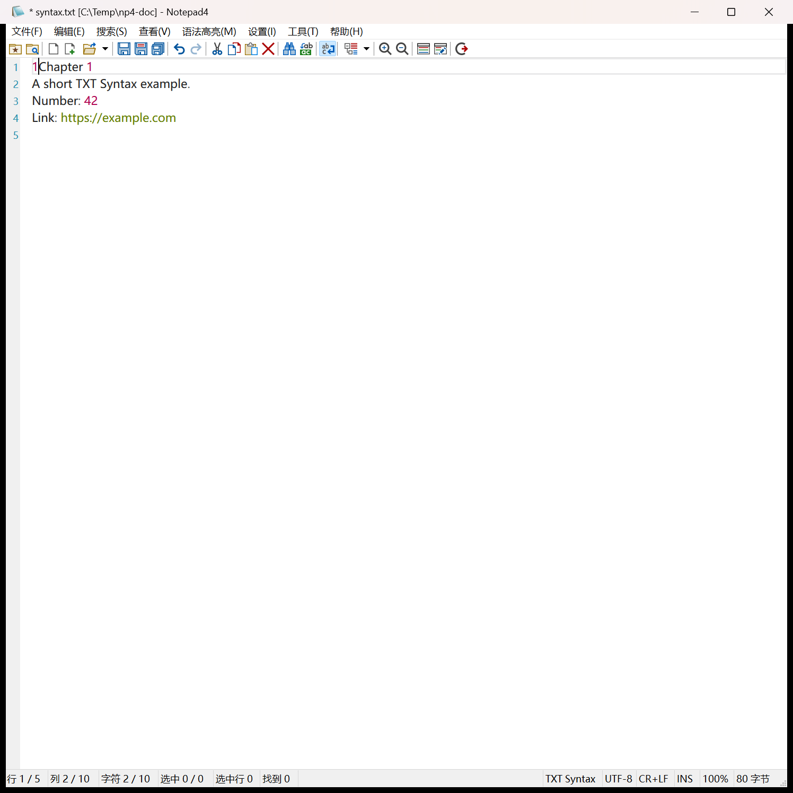
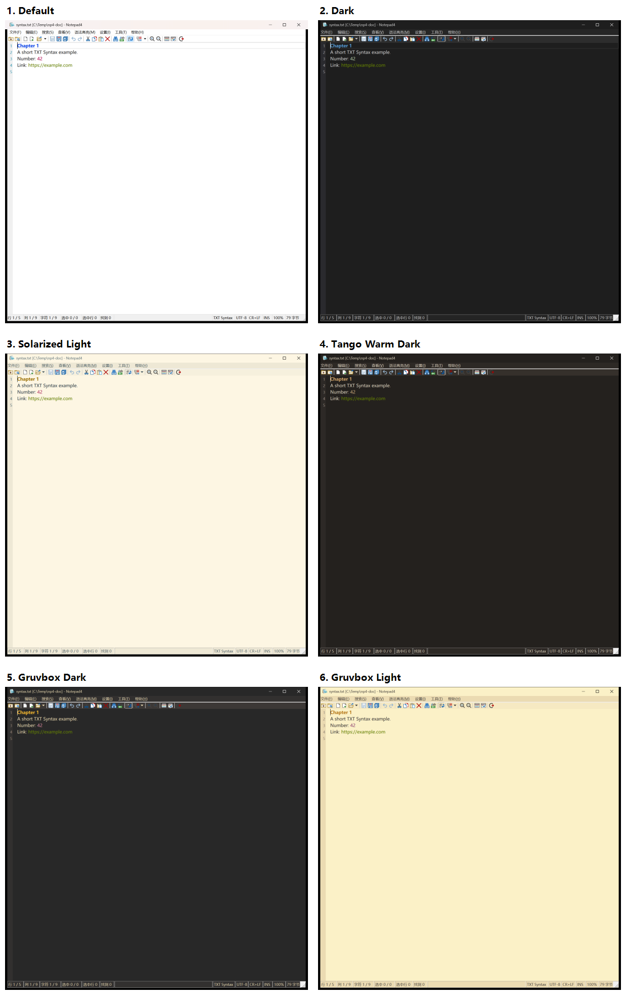
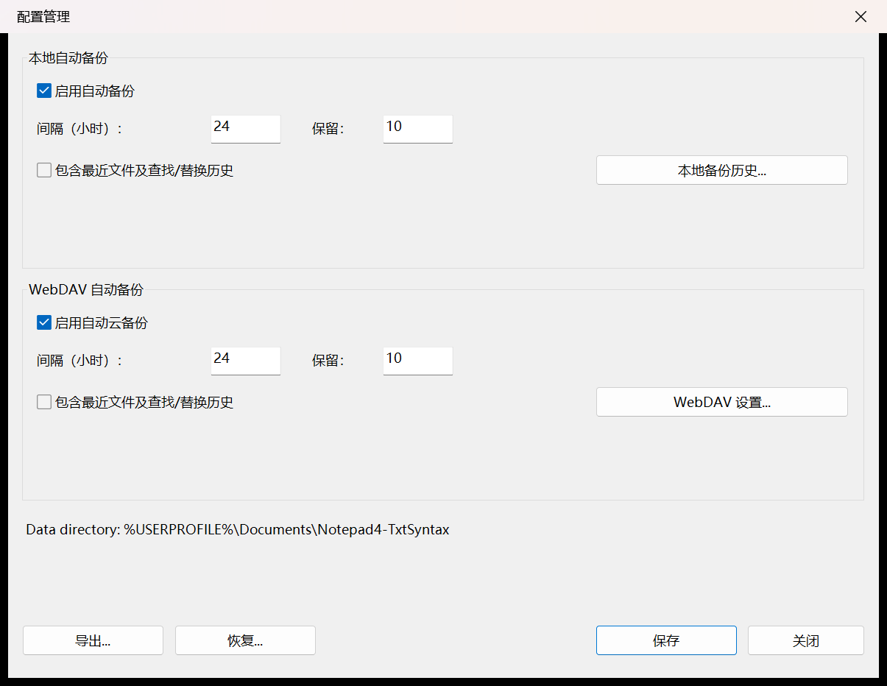
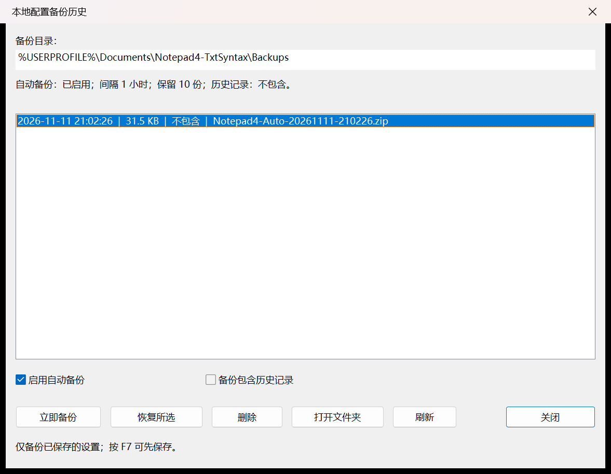
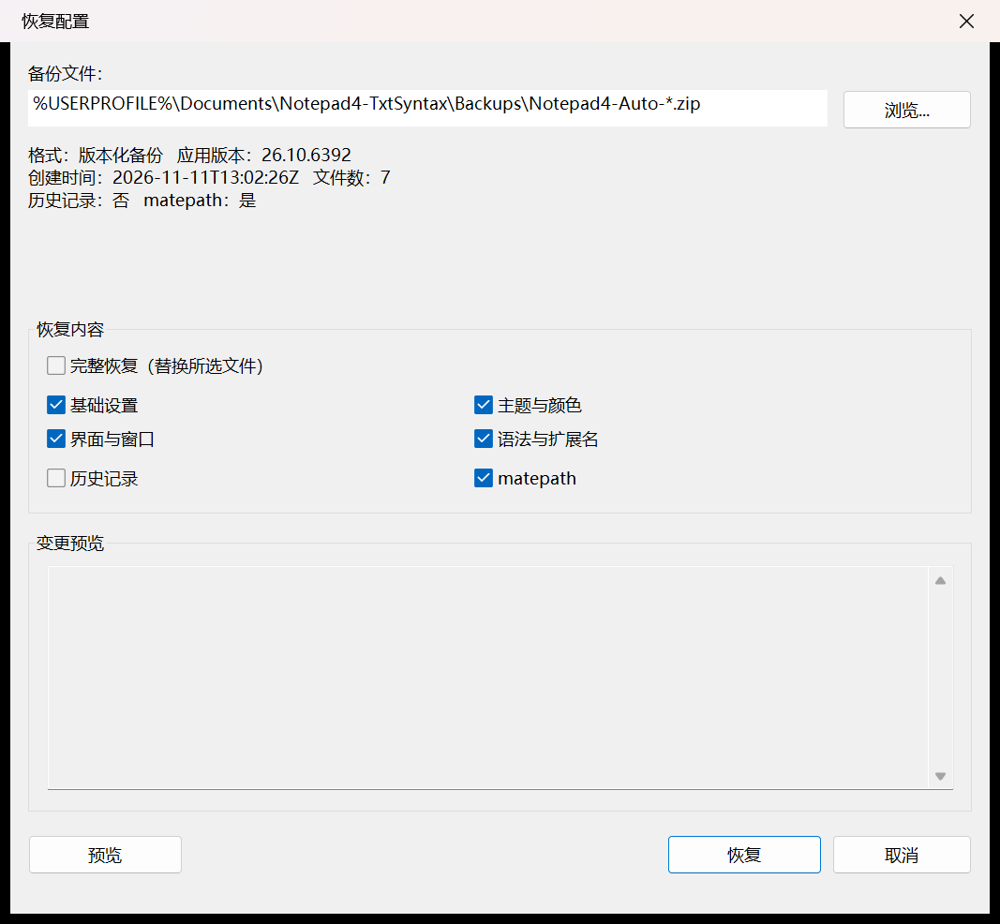
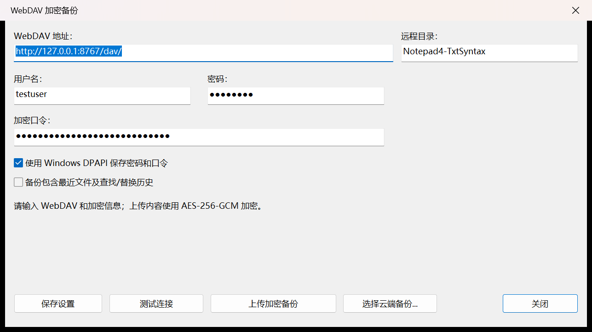
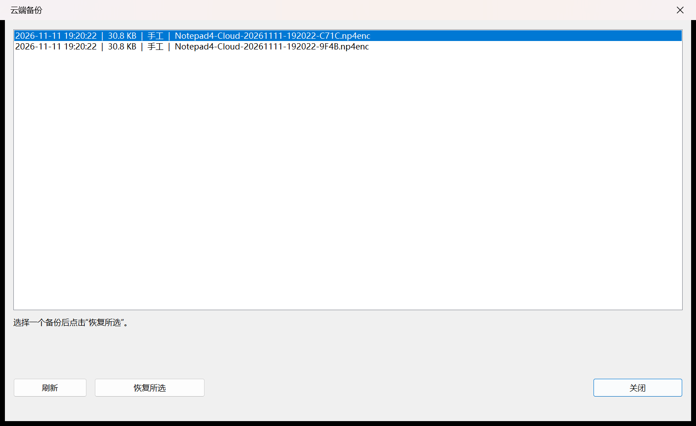
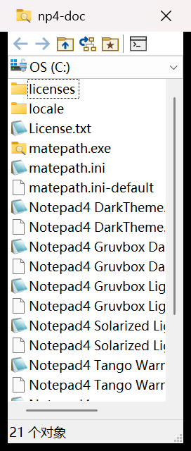

# Notepad4-TxtSyntax

基于 [Notepad4](https://github.com/zufuliu/notepad4) 的非官方增强版本，重点补充 TXT Syntax、六套主题、matepath、配置备份/恢复和 WebDAV 云备份。

> 本项目不是 zufuliu/notepad4 官方发布版本。官方编辑器的查找/替换、编码、打印、多窗口和词法方案等核心功能未作为本项目修改目标；改动集中在下列增强模块。

## 功能概览

- **TXT Syntax**：独立的轻量 TXT 词法分析器，支持标题、注释、链接、变量、数字、括号、字符串、分隔符和符号高亮；`.txt` 默认使用，同时保留官方 Text File 方案。
- **六套主题**：Default、Dark、Solarized Light、Tango Warm Dark、Gruvbox Dark、Gruvbox Light；包含标题栏、菜单栏、工具栏、状态栏和编辑区配色。
- **matepath**：便携包包含官方 matepath 文件浏览器和简体中文资源，可由编辑器“浏览文件”调用。
- **配置快照**：版本化 ZIP，包含主配置、五套主题、TXT Syntax 样式和 matepath 配置；manifest 记录 SHA-256，支持排除最近文件/查找替换历史。
- **配置恢复**：原生预览与分类合并/完整替换，支持基础设置、界面与窗口、主题与颜色、语法与扩展名、历史、matepath；恢复前生成回滚快照，事务失败可回滚。
- **本地自动备份**：启动/退出检查、间隔、保留份数、历史列表和内容指纹去重；只清理自动快照，不触碰手工备份。
- **WebDAV 加密备份**：PBKDF2-HMAC-SHA256 + AES-256-GCM，HTTPS-only，DPAPI 保存密码和口令；可列出云端自动/手工备份并任选恢复。
- **自动云备份**：启动后台检查，退出不等待网络；按设备标签隔离自动快照，内容未变化不重复上传。
- **配置管理**：原生对话框集中管理本地/云自动备份策略，并提供导出、恢复、本地历史和 WebDAV 入口。
- **数据迁移**：本地备份在 Documents；设备 ID、凭据、恢复事务/回滚在 LocalAppData；旧数据会安全迁移。

## 界面预览

### TXT Syntax

`.txt` 默认使用新增的 TXT Syntax；标题、链接等按方案着色。



### 六套主题

六套主题逐一切换的编辑区、标题栏、菜单和状态栏效果。



### 配置管理

集中设置本地/WebDAV 自动备份、间隔、保留份数和历史选项，并打开导出/恢复/历史/WebDAV 入口。



### 本地备份历史

查看、立即备份、恢复、删除或打开自动备份目录。



### 配置恢复预览

预览版本、文件数、历史记录/matepath 信息，按分类合并或完整替换。



### WebDAV 加密备份

配置 WebDAV、加密口令和 DPAPI 凭据，执行连接测试、上传和恢复。



### 云端备份列表

按时间、大小和自动/手工类型选择任意云端快照恢复。



### matepath

便携包内置的官方 matepath 文件浏览器，可由编辑器“浏览文件”调用，也可独立启动。



> 截图使用本地测试地址/临时文件；WebDAV 地址为示例，不包含真实凭据。

## 与官方版本的主要差异

| 方向 | 本项目改动 |
|---|---|
| TXT Syntax | 新增独立 TXT 词法器，`.txt` 默认启用 |
| 主题 | 官方 Default/Dark 之外新增四套主题及完整 Win32 界面配色 |
| matepath | 打包官方 matepath 与中文资源，提供默认配置 |
| 配置格式 | 版本化 ZIP、manifest、SHA-256/CRC、旧六 INI ZIP 兼容 |
| 配置恢复 | 原生预览、分类合并、回滚快照、事务日志、启动恢复 |
| 本地备份 | 自动计划、历史、内容指纹去重、保留策略 |
| WebDAV | AES-256-GCM 加密、HTTPS-only、云端历史选择、DPAPI |
| 自动云 | 后台执行、内容去重、设备隔离保留 |
| 配置管理 | 原生策略管理 GUI |
| 数据布局 | Documents/LocalAppData 分工及迁移 |
| 官方核心 | 查找/替换、编码、打印、多窗口、词法方案未修改 |

## 便携版构建

在 Visual Studio 2026 的 MSBuild 环境中执行：

```powershell
powershell -ExecutionPolicy Bypass -File build\package-portable.ps1
```

脚本构建 x64 Release 的 Notepad4、matepath 和简体中文资源，在 `build\` 下暂存并校验后发布到同级 `Notepad4-TxtSyntax-Portable`。全新 ZIP 只包含 7 个 `*.ini-default`（主配置、五套主题、matepath），首次运行才生成用户 `*.ini`；升级不覆盖已有用户配置。打包校验固定根目录、`locale\zh-Hans\` 和 `licenses\` 结构，排除用户 INI、备份、测试数据、脚本和 `tree.txt`。

## 数据位置

- 本地自动备份：`%USERPROFILE%\Documents\Notepad4-TxtSyntax\Backups`
- 恢复事务/回滚、设备 ID、云凭据：`%LOCALAPPDATA%\Notepad4-TxtSyntax`
- 旧 Documents 数据及旧 LocalAppData 备份 ZIP 会安全迁移；不覆盖现有文件、不删除旧文件
- 便携程序目录保留用户 `*.ini`；发行 ZIP 不包含用户配置

## 文档

- [COMPATIBILITY.md](COMPATIBILITY.md)：兼容性与已知限制

## 许可证与上游

本项目基于 [zufuliu/notepad4](https://github.com/zufuliu/notepad4)，保留原项目许可证和作者信息。便携包内包含：

- [License.txt](License.txt)
- [licenses/matepath-License.txt](licenses/matepath-License.txt)
- [licenses/TXT-Syntax-MIT.txt](licenses/TXT-Syntax-MIT.txt)

本项目不是官方 Notepad4 发行版，使用前请自行评估和备份配置。
